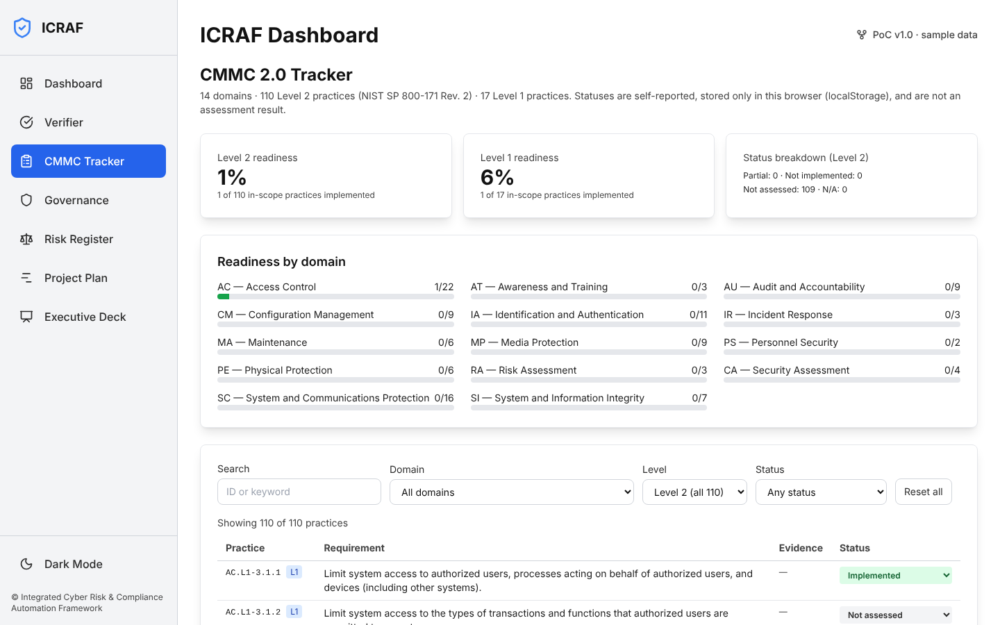
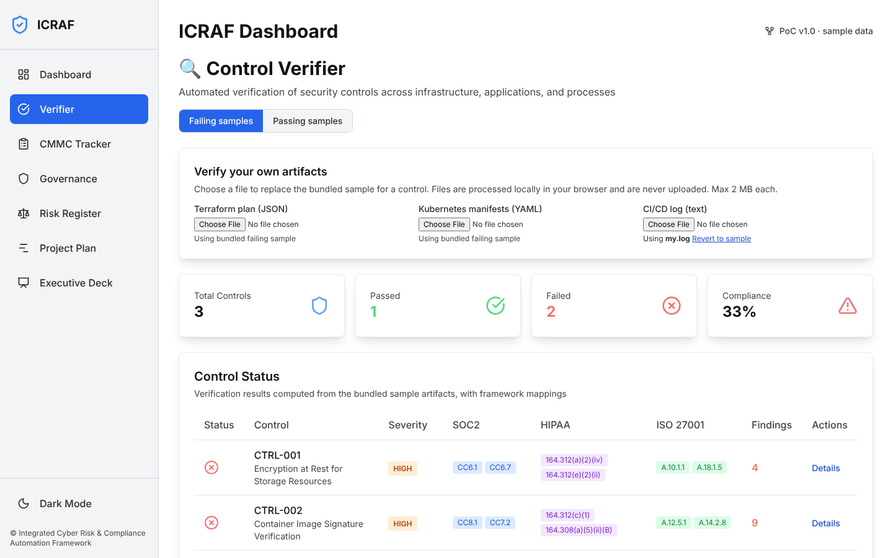
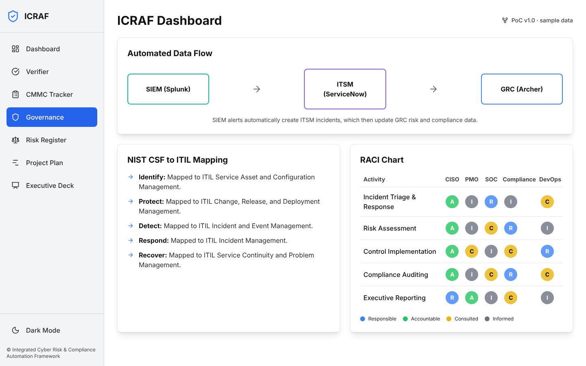
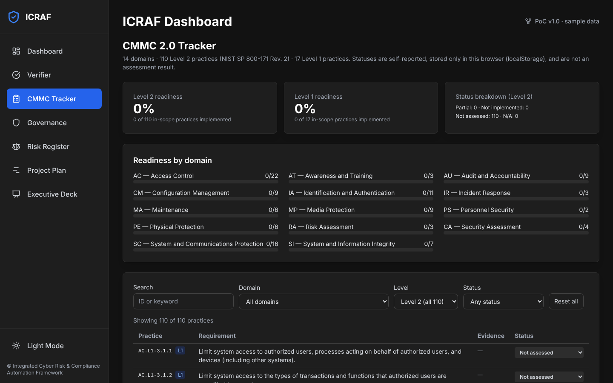

# ICRAF: Integrated Cyber Risk and Compliance Dashboard

> Integrated Cyber Risk and Compliance Automation Framework (ICRAF) — a browser-based unified dashboard for CMMC 2.0, NIST 800-171, and multi-framework compliance tracking with automated control verification.

[](https://www.typescriptlang.org/) [](https://react.dev/) [](https://dodcio.defense.gov/CMMC/) [](https://csrc.nist.gov/publications/detail/sp/800/171/rev-3/final) [](LICENSE)

---

## Overview

1. Browser-based, no-backend compliance dashboard built with React 19 and TypeScript, running entirely client-side via Vite.
2. Provides a unified security posture view combining KPI telemetry, NIST CSF radar coverage, incident tracking, and an interactive risk register in a single pane of glass.
3. Includes an interactive CMMC 2.0 Tracker: all 14 domains and 110 Level 2 practices (NIST SP 800-171 Rev. 2), the 17 Level 1 practices flagged, filters, per-practice self-reported status stored in the browser, and readiness scores by level and domain.
4. Includes an automated Control Verifier that parses Terraform plan JSON, Kubernetes manifests, and CI/CD log files to produce pass/fail compliance evidence mapped to SOC2, HIPAA, and ISO 27001.
5. Features a Governance Blueprint illustrating the SIEM-to-ITSM-to-GRC automated data flow with NIST CSF-to-ITIL mappings and a full RACI matrix.
6. Ships with sample passing and failing fixture files, OPA/Kyverno/detect-secrets policy files, and a complete operational runbook to support auditor review and evidence collection.

---

## Architecture

```
┌─────────────────────────────────────────────────────────┐
│              Browser Application (React + Vite)         │
│                                                         │
│  ┌──────────────────────────────────────────────────┐   │
│  │                    App.tsx (Router)              │   │
│  └──────┬──────────────────────────────────────┬───┘   │
│         │                                      │        │
│  ┌──────▼──────┐   ┌──────────────┐   ┌───────▼─────┐ │
│  │  Unified    │   │   Control    │   │  Governance  │ │
│  │  Dashboard  │   │   Verifier   │   │  Blueprint   │ │
│  │  (KPIs,     │   │  (Terraform/ │   │  (SIEM→ITSM  │ │
│  │  Incidents, │   │   K8s/CI-CD  │   │  →GRC, RACI) │ │
│  │  CSF Radar) │   │   checks)    │   └──────────────┘ │
│  └─────────────┘   └──────┬───────┘                    │
│                            │                            │
│  ┌──────────────┐   ┌──────▼──────┐   ┌─────────────┐ │
│  │  Interactive │   │  Project    │   │  Executive  │ │
│  │  Risk        │   │    Plan     │   │     Deck    │ │
│  │  Register    │   │  (Timeline) │   │  (Slide     │ │
│  │  (Sortable,  │   │             │   │   Briefing) │ │
│  │   Scored)    │   └─────────────┘   └─────────────┘ │
│  └──────────────┘                                      │
│                                                         │
│  ┌──────────────────────────────────────────────────┐   │
│  │            Mock Data Layer                       │   │
│  │  data/mockData.ts  │  data/controlMap.ts         │   │
│  │  verifiers/        │  samples/  │  policies/     │   │
│  └──────────────────────────────────────────────────┘   │
└─────────────────────────────────────────────────────────┘
```

---

## Key Features

### Unified Dashboard

The main dashboard aggregates security telemetry into a single view for security managers and executives. It surfaces the metrics most critical for day-to-day operations and board-level reporting.

- Mean Time to Detect (MTTD) and Mean Time to Respond (MTTR) KPI cards
- Live-updating high-severity incident feed
- NIST Cybersecurity Framework (CSF) control coverage visualized as a radar chart
- Color-coded risk scoring and status indicators throughout

### Control Verifier

The Control Verifier transforms ICRAF from a visualization tool into a verifiable security posture system. Rather than displaying static data, it parses real file formats and produces auditable pass/fail results.

| Control | Source | Frameworks Mapped |
| --- | --- | --- |
| CTRL-001: Encryption at Rest | Terraform plan JSON | SOC2 CC6.1, HIPAA 164.312(a)(2)(iv), ISO 27001 A.10.1.1 |
| CTRL-002: Image Signature Verification | Kubernetes manifests | SOC2 CC8.1, HIPAA 164.312(c)(1), ISO 27001 A.12.5.1 |
| CTRL-003: Secrets Detection | CI/CD log files | SOC2 CC6.1, HIPAA 164.312(a)(1), ISO 27001 A.9.4.1 |

Each control produces resource-level findings, severity ratings, and step-by-step remediation guidance. Passing and failing sample fixture files are included under `samples/` for auditor review.

### CMMC 2.0 Tracker

The CMMC Tracker (`components/CmmcTracker.tsx`, data in `data/cmmcPractices.ts`, reference in `CMMC-MAPPING.md`) covers the CMMC 2.0 model:

- 14 domains (AC, AT, AU, CM, IA, IR, MA, MP, PS, PE, RA, CA, SC, SI) and 110 Level 2 practices from NIST SP 800-171 Rev. 2; 17 of them are the Level 1 practices
- Search and filter by domain, level, and status
- Self-reported status per practice (Not assessed, Not implemented, Partial, Implemented, Not applicable), persisted in the browser's `localStorage` only
- Readiness score for Level 1 and Level 2 (implemented / in-scope practices; "partial" counts as not yet implemented; N/A is excluded), plus per-domain progress bars
- Three practices link to Control Verifier controls as *supporting* evidence (SC.L2-3.13.16, CM.L2-3.4.8, IA.L2-3.5.10)

Statuses are planning aids, not assessment results. Level 3 (NIST SP 800-172) is out of scope. Requirement text is condensed; confirm against NIST and the DoD CMMC Assessment Guides before relying on it.

### Interactive Risk Register and Governance Blueprint

The Risk Register provides a sortable, scored table of identified risks. Each entry carries an impact score, likelihood score, composite risk score, owner, and remediation status. Sorting by any column surfaces highest-priority items immediately.

The Governance Blueprint illustrates the automated data flow from SIEM (Splunk) through ITSM (ServiceNow) to GRC (Archer), with NIST CSF controls mapped to corresponding ITIL processes and a full RACI matrix for all key activities.

### Security and Compliance

- CMMC 2.0 Level 1 and Level 2 (14 domains, 110 practices; NIST SP 800-171 Rev. 2)
- NIST SP 800-171 Rev 3 (Moderate baseline, Level 2 alignment)
- NIST Cybersecurity Framework (CSF) — Identify, Protect, Detect, Respond, Recover
- SOC2 Type II — CC6.1, CC6.7, CC8.1 automated evidence
- HIPAA Technical Safeguards — 164.312 encryption, integrity, access control
- ISO 27001 Annex A — A.9.4.1, A.10.1.1, A.12.5.1
- OPA (Open Policy Agent), Kyverno, and detect-secrets policy files included in repository

---

## Quick Start

### Prerequisites

- Node.js 18 or later
- npm 9 or later

### Local Development

```bash
# Clone the repository
git clone https://github.com/dbsectrainer/integrated-cyber-risk-compliance.git
cd integrated-cyber-risk-compliance

# Install dependencies
npm install

# Start the development server (runs on http://localhost:3000)
npm run dev

# Lint, typecheck, unit tests, production build
npm run check
```

The application runs entirely in the browser with no backend, no database, and no API keys required. Dashboard data comes from `data/mockData.ts`; the Verifier analyzes the files in `samples/`, which are bundled at build time.

### Production Build

```bash
# Build for production
npm run build

# Preview the production build locally
npm run preview
```

The output in `dist/` is a static bundle that can be served from any static hosting provider (S3, GitHub Pages, Netlify, Vercel, etc.).

---

## Production Ready Status

**Frontend prototype complete — compliance evidence infrastructure in place**

- React 19 + TypeScript 5.8 + Vite 6 build pipeline with no compilation errors
- Seven interactive views: Dashboard, Control Verifier, CMMC Tracker, Governance Blueprint, Risk Register, Project Plan, Executive Deck
- Automated control verification logic implemented in `verifiers/` with real Terraform, Kubernetes, and CI log parsers
- Passing and failing sample fixture files present in `samples/` for all three controls
- OPA, Kyverno, and detect-secrets policy files present in `policies/`
- CMMC 2.0 domain/practice data (`data/cmmcPractices.ts`) and reference tables in `CMMC-MAPPING.md`
- Operational runbook present at `RUNBOOK.md`
- MIT license included
- No backend dependency — runs entirely client-side

### Verification

```bash
npm ci
npm run check        # lint + typecheck + unit tests + production build
npm run test:e2e     # build, serve with `vite preview`, run Playwright e2e + axe accessibility audit
```

`npm run test:e2e` needs Playwright's Chromium (`npx playwright install chromium` if it is not already installed). Set `BROWSER=firefox` or `BROWSER=webkit` (after installing them) and `SHOTS=0` to run the same checks in another engine without overwriting the evidence files.

Latest verified results, logs, and screenshots are in [`docs/evidence/verification-report.md`](docs/evidence/verification-report.md).

### Screenshots (captured from the running production build by `scripts/e2e.mjs`)

| View | Screenshot |
| --- | --- |
| Dashboard (desktop) |  |
| CMMC Tracker |  |
| Control Verifier, failing samples, CTRL-003 details |  |
| Control Verifier, passing samples |  |
| Control Verifier, uploaded custom CI log |  |
| Governance (RACI) |  |
| Risk Register (sorted) |  |
| Dashboard (mobile 390px) |  |
| CMMC Tracker (dark) |  |

### Known Limitations

- All dashboard data (KPIs, incidents, risks, RACI, project plan) is static sample data, clearly labelled "sample data" in the UI. There is no SIEM/ITSM/GRC integration, backend, or authentication; those are roadmap items (`ROADMAP.md`) that need external systems.
- The Control Verifier analyses either the bundled samples or files you choose in the browser (processed locally, 2 MB max). Only three controls are implemented, and only the checks described in `verifiers/` (e.g. the Kubernetes check is limited to image digest, tag, registry, and signature-annotation rules).
- CMMC Tracker statuses are self-reported and stored in `localStorage` (per browser, not shared or exported). CMMC requirement text is condensed; Level 3 is not covered.
- Verified in Chromium only. Firefox and WebKit could not be installed in the audit environment (the Playwright download host was blocked); the e2e script supports them via `BROWSER=`.
- Accessibility was audited with axe-core (WCAG 2.0/2.1 A/AA + best-practice rules) on all views in light and dark mode; automated rules do not replace a manual screen-reader review.
- Inter is loaded from Google Fonts; offline it falls back to the system sans-serif.

---

## Project Structure

```
integrated-cyber-risk-compliance/
├── components/
│   ├── shared/
│   │   ├── Card.tsx              # Reusable card wrapper
│   │   └── KpiCard.tsx           # KPI metric display card
│   ├── CmmcTracker.tsx           # CMMC 2.0 tracker view
│   ├── Dashboard.tsx             # Unified dashboard view
│   ├── Governance.tsx            # Governance blueprint view
│   ├── Presentation.tsx          # Executive slide deck view
│   ├── ProjectPlan.tsx           # Project plan / Gantt view
│   ├── RiskRegister.tsx          # Interactive risk register
│   ├── Sidebar.tsx               # Navigation sidebar
│   └── Verifier.tsx              # Control verifier view
├── contexts/
│   └── ThemeContext.tsx          # Theme context provider
├── data/
│   ├── cmmcPractices.ts          # CMMC 2.0: 14 domains, 110 practices
│   ├── cmmcScore.ts              # Readiness scoring
│   ├── controlMap.ts             # Control-to-framework mappings
│   └── mockData.ts               # Mock data for all views
├── verifiers/
│   ├── ciLogsVerifier.ts         # CI/CD log parser
│   ├── kubernetesVerifier.ts     # Kubernetes manifest parser
│   └── terraformVerifier.ts      # Terraform plan JSON parser
├── samples/
│   ├── ci-logs/
│   │   ├── failing/secrets-detected.log
│   │   └── passing/clean-build.log
│   ├── kubernetes/
│   │   ├── failing/unsigned-deployment.yaml
│   │   └── passing/signed-deployment.yaml
│   └── terraform/
│       ├── failing/unencrypted-storage.json
│       └── passing/encrypted-s3.json
├── policies/
│   ├── ci-cd/secrets-detection.yaml
│   ├── kubernetes/image-signature-verification.yaml
│   └── terraform/encryption-at-rest.rego
├── tests/                        # Vitest unit tests (verifiers, CMMC data/scoring, sample-data integrity)
├── scripts/e2e.mjs               # Playwright e2e + axe accessibility audit + screenshots
├── docs/evidence/                # Verification report, logs, screenshots
├── tailwind.config.js            # Tailwind (bundled, no CDN)
├── eslint.config.js              # ESLint flat config
├── App.tsx                       # Main application router
├── constants.ts                  # Navigation items and constants
├── index.html                    # HTML entry point
├── index.tsx                     # React entry point
├── types.ts                      # TypeScript type definitions
├── vite.config.ts                # Vite configuration
├── tsconfig.json                 # TypeScript configuration
├── package.json                  # Dependencies and scripts
├── CMMC-MAPPING.md               # Full CMMC 2.0 domain/practice listing
├── RUNBOOK.md                    # Operational runbook
└── ROADMAP.md                    # Project roadmap
```

---

## BE EASY ENTERPRISES Federal Portfolio

| Showcase Project | Repository | Description |
| --- | --- | --- |
| **Secure RAG Pipeline** | [Secure-Generative-AI-Platform-on-AWS](https://github.com/dbsectrainer/Secure-Generative-AI-Platform-on-AWS) | AWS Bedrock + RAG with FedRAMP High alignment |
| **DevSecOps CI/CD** | [dod-cybersec-ops-framework](https://github.com/dbsectrainer/dod-cybersec-ops-framework) | DoD 8570 / NIST RMF aligned pipeline |
| **Zero Trust Architecture** | [AEGIS](https://github.com/dbsectrainer/AEGIS) | FedRAMP High + NIST 800-207 Zero Trust |
| **FedRAMP Control Automation** | [nist_800_53_scanner](https://github.com/dbsectrainer/nist_800_53_scanner) | NIST 800-53 Rev 5 compliance scanner |
| **Federal AI Governance** | [ai-safety-governance](https://github.com/dbsectrainer/ai-safety-governance) | EO 14110 / OMB M-24-10 aligned |
| **CMMC 2.0 Dashboard** | **[integrated-cyber-risk-compliance](https://github.com/dbsectrainer/integrated-cyber-risk-compliance)** | **This repo** |
| **FedRAMP 30-Day Guide** | [cloud-security-best-practices](https://github.com/dbsectrainer/cloud-security-best-practices) | Day-by-day FedRAMP implementation roadmap |
| **Agentic AI Workflow** | [federal-doc-triage-agent](https://github.com/dbsectrainer/federal-doc-triage-agent) | Production-ready LangGraph + Bedrock triage agent |

---

## Author

**Donnivis Baker** — [github.com/dbsectrainer](https://github.com/dbsectrainer)
**BE EASY ENTERPRISES** — Federal IT Modernization & Cybersecurity

For questions, partnerships, or federal engagement inquiries, open an issue or reach out directly.

**Document Version:** 1.0 | **Last Updated:** 2026-06-15 | **CMMC 2.0:** Level 2 (Advanced)
